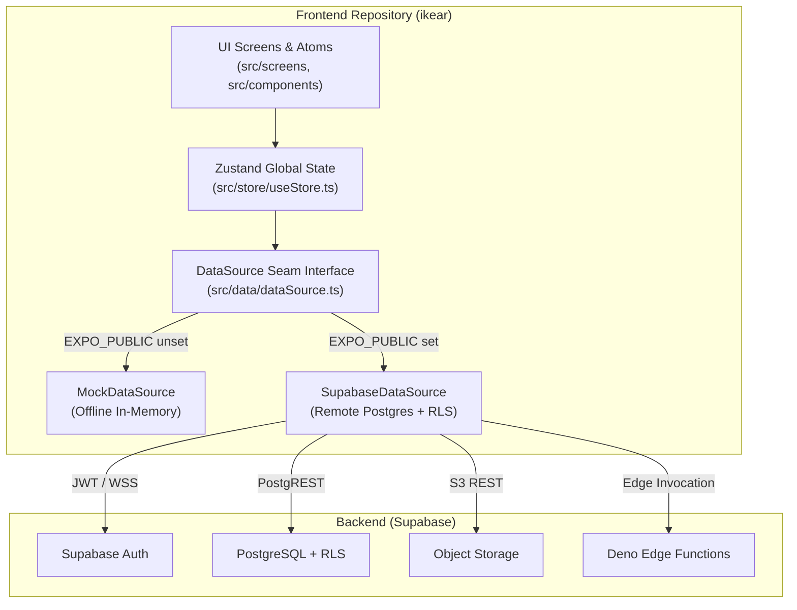

# IKEAR · Second-Hand Furniture C2C Marketplace

[](https://github.com/HairuoLiu/ikear/actions/workflows/ci.yml)
[](https://github.com/HairuoLiu/ikear)
[](LICENSE)
[](https://expo.dev)

**IKEAR** is a specialized peer-to-peer (C2C) marketplace application for second-hand IKEA furniture. Built with **React Native** and **Expo SDK 51**, the project uses a single unified TypeScript codebase that compiles simultaneously to native mobile applications (iOS and Android) and modern Web Single-Page Applications (SPA).

---

## Interactive UI Preview & Design Showcase

You can preview and interact with all screens in the high-fidelity simulator without running native toolchains:

*   **Interactive Design System Showcase:** Open [`ui-design-showcase.html`](file:///Users/hai/.gemini/antigravity/brain/468488aa-bd86-465e-968c-7630534a9160/ui-design-showcase.html) in your browser to test interactive flows (Discovery, Listing Details, Guided 5-Angle Camera, In-App Chat, Lifecycle Management, and Face ID Biometric Lock).
*   **Web App Prototype:** Open `preview/index.html` for the embedded standalone device frame preview.

---

## Architectural Overview

The application compiles into three distribution targets sharing over 90% of business logic, state stores, and presentational components:

| Target | Artifact | Repository | Deployment Goal |
| :--- | :--- | :--- | :--- |
| **Mobile Application** | iOS IPA / Android APK/AAB | `ikear` (Public) | App Store & Google Play via EAS Build |
| **Web Application** | Responsive SPA | `ikear` (Public) | Vercel & Cloudflare Pages |
| **Backend Services** | Database, Auth, Storage, Edge Functions | `ikear-backend` (Private) | Managed Supabase Platform |



---

## Core Product Capabilities

1.  **Ultra-Simple ≤ 5 Screens Architecture:** The entire app experience is consolidated into 5 high-density, single-task screens:
    *   **Screen 1: Discovery (`HomeScreen`)** — 12 IKEA taxonomy grids, geographic sub-filtering, multi-factor recommendation sort.
    *   **Screen 2: Inspection & Deal (`ListingDetailScreen`)** — 5-angle verification badge, reference photo notice, inline counter-offer.
    *   **Screen 3: AI Fast Publish (`CreateListingScreen`)** — Instant computer vision model recognition, MSRP valuation, auto-filled form, and chat-to-list no-photo mode.
    *   **Screen 4: Unified Hub (`ProfileScreen`)** — 3-in-1 consolidated console managing Active Listings Lifecycle, In-App Offer Messages Inbox, and System Settings.
    *   **Screen 5: Fast Auth (`AuthScreen`)** — Native Sign in with Apple and friction-free demo login.
2.  **9 Mainstream Languages Instant Hot-Switching:** Supports runtime language switching across 9 worldwide languages in settings without reload:
    *   🇨🇳 Simplified Chinese (`zh-CN`), 🇭🇰 Traditional Chinese (`zh-TW`), 🇨🇦 English (`en`), 🇫🇷 French (`fr`), 🇪🇸 Spanish (`es`), 🇯🇵 Japanese (`ja`), 🇰🇷 Korean (`ko`), 🇩🇪 German (`de`), 🇸🇪 Swedish (`sv`).
3.  **AI Vision Model Valuation & Auto-Fill:** Photos taken trigger instant sub-second recognition of IKEA classic models (POÄNG, BILLY, MALM, KALLAX, SÖDERHAMN), filling 90% of listing details automatically.
4.  **No-Photo Chat-to-List Mode & 65% Exposure Penalty:** Allows users without camera photos to describe items via chat. Listings are posted with official reference illustrations, flagged with warnings, and given a `0.35x` exposure weight to protect buyer trust while rewarding multi-photo listings (`1.30x`).
5.  **4-Tier Seller Trust Rating System:** Profiles are calculated into Bronze, Silver, Gold, and Crown tiers, multiplying search ranking priority and providing verifiable trust badges.
6.  **30-Day Listing Lifecycle:** Automated 30-day expiration window with 3-day reminder notifications; one-click refresh awards 24-hour priority search boost.
7.  **Biometric Lock & Security:** Hardware-level Face ID and Touch ID support on native devices with graceful fallback on Web.

---

## Prerequisites

Before running the application locally, ensure your environment meets the following requirements:

*   **Node.js:** v18.0.0 or higher (v20+ recommended)
*   **Package Manager:** `npm` v9.0.0 or higher
*   **Expo CLI:** `npm install -g expo-cli` (or run via `npx expo`)
*   **For iOS Native Simulators:** macOS with Xcode 15+ and CocoaPods installed
*   **For Android Native Emulators:** Android Studio with Android SDK API Level 34+

---

## Quickstart Guide

### 1. Clone and Install Dependencies

```bash
git clone https://github.com/HairuoLiu/ikear.git
cd ikear
npm install
```

### 2. Run on Web (Browser)

```bash
npx expo start --web
```
*   The application automatically opens at `http://localhost:19006` or `http://localhost:8081`.
*   On desktop viewports, the interface automatically adopts a centered, 480px maximum-width mobile frame.

### 3. Run on Mobile (iOS / Android)

```bash
npx expo start
```
*   Scan the terminal QR code using **Expo Go** on your physical mobile device.
*   Alternatively, press <kbd>i</kbd> to launch in the iOS Simulator or <kbd>a</kbd> for Android Emulator.
*   *Demo Credentials:* Use any valid email format and password to enter the application immediately in mock mode.

---

## Environment Configuration

The application defaults to `mockDataSource` when environment variables are omitted. To connect to a live Supabase backend:

1.  Copy the environment template:
    ```bash
    cp .env.example .env.local
    ```
2.  Populate your Supabase project parameters:
    ```ini
    EXPO_PUBLIC_SUPABASE_URL=https://your-project-id.supabase.co
    EXPO_PUBLIC_SUPABASE_ANON_KEY=your-anon-key-here
    ```
3.  Restart the development server (`npx expo start`). The application detects the variables and switches to `supabaseDataSource` automatically.

| Variable | Required | Description |
| :--- | :--- | :--- |
| `EXPO_PUBLIC_SUPABASE_URL` | No (Defaults to Mock) | HTTPS endpoint for Supabase project instance |
| `EXPO_PUBLIC_SUPABASE_ANON_KEY` | No (Defaults to Mock) | Public anonymous JWT API key safe for client bundles |

---

## Testing & Quality Gates

The codebase enforces strict quality gates on every commit.

```bash
# Run complete unit and integration test suite (253 tests)
npm test

# Run isolated end-to-end user journey tests
npm run e2e
```

### Test Suite Breakdown

*   **Taxonomy & Metadata:** 6 tests validating 12+ categories, emoji mapping, and type guards.
*   **Listing Creation & Validation:** 11 tests verifying mandatory field checks and 30-day TTL calculation.
*   **DataSource Filtering & Search:** 14 tests validating sorting algorithms (`near`, `new`, `price`), keyword queries, and multi-filter criteria.
*   **Lifecycle & Renewal Engine:** 15 tests verifying 3-day reminder window, 24h boost expiration, and mark-sold operations.
*   **Photo Guidance Engine:** 18 tests asserting hard minimum (2) and soft suggestion (3) photo boundaries.
*   **Messaging & Thread Indexing:** 16 tests asserting unread count calculation, thread immutability, and message previews.

---

## Documentation Directory

| Document | Purpose |
| :--- | :--- |
| [`docs/DESIGN_SYSTEM.md`](docs/DESIGN_SYSTEM.md) | Complete color palettes, typography scales, spacing tokens, and component specifications. |
| [`docs/ARCHITECTURE.md`](docs/ARCHITECTURE.md) | Layered system topology, data contracts, security model, and platform boundaries. |
| [`docs/API_REFERENCE.md`](docs/API_REFERENCE.md) | Technical reference for `DataSource`, Zustand store actions, and utility modules. |
| [`docs/CONTRIBUTING.md`](docs/CONTRIBUTING.md) | Development workflow, branching conventions, code style, and PR checklist. |
| [`PRODUCT_SPEC.md`](PRODUCT_SPEC.md) | Functional product specifications and PM alignment notes. |
| [`CLOUDFLARE_DEPLOY.md`](CLOUDFLARE_DEPLOY.md) | Guide for deploying static web bundles to Cloudflare Pages. |

---

## Troubleshooting

### Port Conflicts
If port 8081 or 19006 is occupied:
```bash
npx expo start --web --port 8082
```

### Clearing Cache
If bundle assets appear stale after changing dependencies or configuration:
```bash
npx expo start -c
```

---

## License

This project is licensed under the [MIT License](LICENSE).
