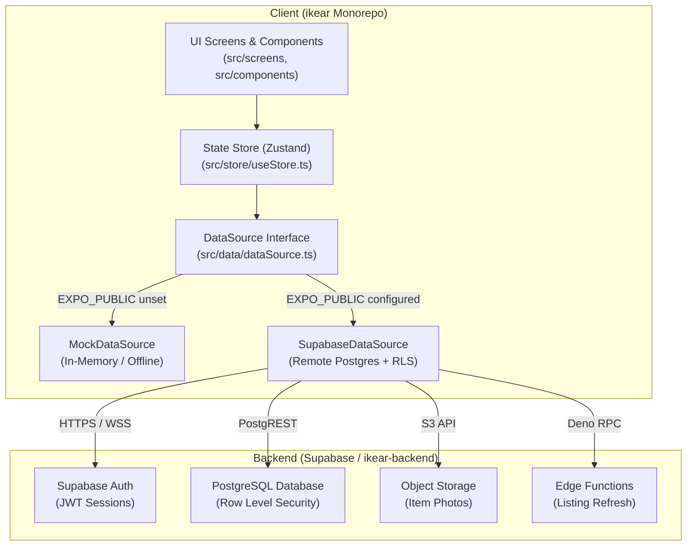
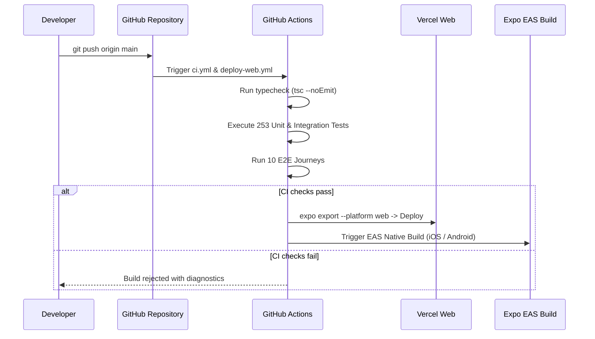

# IKEAR Technical Architecture Guide

This document describes the architectural design, repository structure, data contracts, security mechanisms, and offline synchronization strategy for the **IKEAR** C2C second-hand furniture marketplace.

---

## 1. System Overview

IKEAR is built as a cross-platform client with an offline-first architecture, powered by React Native and Expo SDK 51. The frontend compiles into three distinct distribution targets from a single unified codebase:

1.  **iOS Application:** Native binary distributed via Apple App Store and TestFlight.
2.  **Android Application:** Native binary distributed via Google Play Store.
3.  **Web Progressive Web Application:** Single Page Application (SPA) deployed to Vercel or Cloudflare Pages.



---

## 2. Layered Architecture

The application strictly enforces a four-tier architecture:

### 2.1 Presentation Layer (`src/screens`, `src/components`)
*   Contains React components, layout containers, and styling definitions.
*   Interacts only with state hooks (`useStore`) and business logic modules (`src/lib`).
*   Does **not** directly import or query the Supabase client or network endpoints.

### 2.2 State Layer (`src/store/useStore.ts`)
*   Managed by Zustand with AsyncStorage persistence.
*   Holds the active user session, cached listings, active filters, draft listings, and unread message indicators.
*   Coordinates mutations across the `DataSource` interface and provides reactive subscriptions to UI components.

### 2.3 Data Seam Layer (`src/data/dataSource.ts`)
*   Defines the contract interface `DataSource` containing CRUD operations for listings, conversations, messages, and user profiles.
*   Performs dynamic implementation resolution at runtime:
    *   If `EXPO_PUBLIC_SUPABASE_URL` and `EXPO_PUBLIC_SUPABASE_ANON_KEY` are present, `supabaseDataSource` is activated.
    *   If credentials are absent, `mockDataSource` is activated automatically without throwing errors or requiring configuration.

### 2.4 Service & Network Layer (`src/lib/supabase.ts`, `src/data/supabaseDataSource.ts`)
*   Handles camelCase to snake_case schema translation.
*   Manages WebSocket subscriptions for Realtime messaging.
*   Enforces error handling and fallback behaviors.

---

## 3. Platform Isolation and Multi-Targeting

Because iOS, Android, and Web share over 90% of their business logic and view hierarchies, platform divergence is strictly contained in three designated boundaries:

| Divergence Point | Native Implementation (`.native.ts`) | Web Implementation (`.ts`) | Isolation Mechanism |
| :--- | :--- | :--- | :--- |
| **Biometric Auth** | `expo-local-authentication` (Face ID / Touch ID) | No-op stub / WebAuthn fallback | Metro file-extension resolution (`.native.ts` vs `.ts`) |
| **Desktop Layout** | Fullscreen view | Centered 480px maximum-width column container | `Platform.OS === 'web'` conditional container (`App.tsx`) |
| **Media Picking** | Native camera and system photo library picker | Standard HTML5 file picker | `expo-image-picker` unified platform driver |

---

## 4. Canonical Data Contract

The core domain model is defined in `src/data/types.ts`. All backend database rows are mapped to this canonical structure before reaching the state store.

```typescript
export interface Listing {
  id: string;                     // Unique identifier (UUID or mock ID)
  title: string;                  // Furniture title
  description: string;            // Detailed condition and logistics description
  price: number;                  // Price in local currency units
  condition: Condition;           // '全新' | '良好' | '一般' | '磨损'
  category: CategoryId;           // One of 15 IKEA taxonomy categories
  photos: string[];               // Image URLs or local cache URIs
  coverIndex: number;             // Primary image index within photos array
  location: Location;             // { city: string, district?: string }
  sellerId: string;               // Reference to user profile ID
  createdAt: string;              // ISO 8601 timestamp
  expiresAt: string;              // ISO 8601 timestamp (TTL: 30 days)
  status: ListingStatus;          // 'active' | 'expired' | 'sold' | 'archived'
  type: ListingType;              // 'secondhand' | 'accessory'
  boostedUntil?: string;          // ISO 8601 timestamp for 24h boost promotion
  discount?: number;              // Discount percentage (0-100)
}
```

---

## 5. Security and Data Protection

1.  **Row Level Security (RLS):** All Supabase tables enforce RLS policies. The public `anon` key only has read permissions for active listings and write permissions scoped to authenticated user records.
2.  **Service Role Isolation:** The elevated `service_role` key is **never** embedded or exposed to the client application. Administrative mutations (such as bulk expiration or fee settlement) run exclusively within Deno Edge Functions.
3.  **Local Biometric Lock:** When enabled, the application requires biometric confirmation whenever the app transitions from background to foreground, guarding personal chats and listings.

---

## 6. Build and Deployment Pipeline


