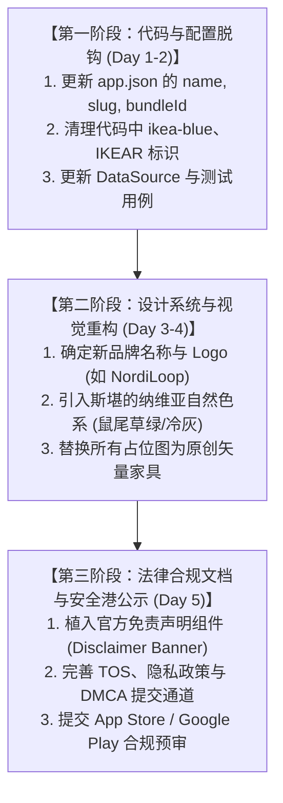

# IKEAR 知识产权合规、侵权边缘与法律风控全景审计报告
# Comprehensive Legal Compliance, IP Risk Audit & Action Plan for IKEAR

> **法律委员会组成成员**：
> 1. **Counsel 1：北美资深知识产权与商标出庭律师**（专注 Lanham Act、加拿大《商标法》、商业外观与混淆可能性诉讼）
> 2. **Counsel 2：欧洲与跨国电商平台合规法律专家**（专注 Inter IKEA Systems B.V. 全球维权模式、权活用尽/首次销售原则与避风港）
> 3. **Counsel 3：工业设计专利、版权与平台技术诉讼律师**（专注家具外观专利、官方图册版权、爬虫抓取合规与反不正当竞争）
> 4. **Counsel 4：消费者权益保护、广告法与应用市场监管专家**（专注虚假宣传、默示关联假冒、Apple/Google 审核规则与 UDRP 域名仲裁）

---

## 目录
1. **背景与调查目标**
2. **第一阶段：四位法务专家独立法律意见与 50 条独立建议（共 200 条）**
   - 2.1 Counsel 1（商标与商业外观专长）：50 条独立风控建议
   - 2.2 Counsel 2（Inter IKEA 维权机制与二手权活用尽专长）：50 条独立风控建议
   - 2.3 Counsel 3（专利、版权与数据采集专长）：50 条独立风控建议
   - 2.4 Counsel 4（消费者假冒、虚假背书与应用商店规则专长）：50 条独立风控建议
3. **第二阶段：法务委员会联席合议与交叉讨论纪要**
4. **第三阶段：最终整合风控解决方案矩阵（按优先级 P0 ~ P3 排序）**
5. **第四阶段：品牌解耦与合规重构落地实施路线图**
6. **附录：官方免责声明标准模板与避风港条款规范（中英双语）**

---

## 1. 背景与调查目标

当前项目名为 **IKEAR**，产品定位为针对多伦多及大多伦多地区（GTA）的“宜家二手家具 C2C 集市”，前端采用 React Native + Expo 构建，支持 iOS、Android 与 Web 三端。

**主要侵权暴恐点与边缘排查范围**：
1. **商标权 (Trademark)**：名称 `IKEAR` 包含驰名商标 `IKEA` 全词，是否构成商标侵权及商标淡化 (Dilution)？
2. **商业外观 (Trade Dress)**：宜家标志性专色（宜家蓝 `#0058A3`、宜家黄 `#FFDB00`）及排版风格是否导致消费者误认为宜家官方出品？
3. **权活用尽 / 首次销售原则 (First Sale Doctrine / Exhaustion of Rights)**：用户买卖二手正品宜家家具的合法边界在哪里？
4. **版权 (Copyright)**：家具官方产品名（如 BILLY、POÄNG）、官方组装手册、官方产品渲染图与尺寸数据的引用边界。
5. **不正当竞争与假冒 (Passing Off / Unfair Competition)**：加拿大《竞争法》与美国 Lanham Act 下是否存在混淆消费者的违法风险。
6. **应用分发渠道下架风险**：Apple App Store Guideline 5.2.1（知识产权）与 Google Play 假冒政策的审查红线。

---

## 2. 第一阶段：四位法务专家独立法律意见与 50 条独立建议

### 2.1 Counsel 1：北美资深知识产权与商标出庭律师（50 条独立建议）

#### 专家案情分析：
`IKEA` 是受世界公认的**超级驰名商标（Famous Trademark）**。在北美（加拿大《商标法》第 20 条及美国 Lanham Act 第 43(c) 条），驰名商标享有跨类保护及“反淡化（Anti-dilution）”与“反弱化（Tarnishment/Blurring）”绝对排他权。`IKEAR` 属于直接将 `IKEA` 加上一个字母 `R`（通常被理解为 Resale、Recycle 或 AR），在司法判例中属于极高败诉率的侵权形态。

#### Counsel 1 的 50 条独立专业建议：
1. **立即废弃 `IKEAR` 作为商业名称与产品标识**：不可在任何公开市场以 IKEAR 作为商标使用。
2. **停止在 iOS Bundle ID 中使用 `com.ikear.app`**：应用包名包含商标同样构成混淆证据。
3. **停止在 Android ApplicationId 中使用 `com.ikear.app`**。
4. **更替根仓库与开源组织命名**：将 `HairuoLiu/ikear` 变更为独立品牌名（如 `FurniShare` 或 `NordicLoop`）。
5. **杜绝申请含有“IKEA”字样的任何类别商标**：申请必定引来 Inter IKEA Systems B.V. 的异议（Opposition）。
6. **避免注册 `ikear.app` / `ikear.ca` 域名**：WIPO UDRP 快速仲裁会在 45 天内将域名无偿裁决给宜家。
7. **剥离“宜家蓝 `#0058A3`”作为主视觉主宰色的地位**：避免在 Logo、启动屏、主按钮同时叠加宜家黄蓝双色。
8. **绝对禁止设计类似宜家椭圆形黄蓝组合的 Logo**：即便改成圆角矩形，若使用蓝底黄字仍构成商业外观侵权。
9. **明确“指示性合理使用 (Nominative Fair Use)”法定边界**：仅允许在具体二手商品描述中客观出现“IKEA”。
10. **平台名称必须体现自身中立身份**：例如改名为 *LoopFurniture: Secondhand Marketplace for IKEA & Nordic Goods*。
11. **在商品标题中禁止将品牌前置造成官方错觉**：引导用户标题格式为“POÄNG Armchair (Made by IKEA)”而非“IKEA Official POÄNG”。
12. **在 App Store 提审副标题中禁用可能引起混淆的表述**：严禁使用“The IKEA Resale App”。
13. **使用规范的归属权声明 (Attribution Notice)**：在启动屏及设置中注明“IKEA is a registered trademark of Inter IKEA Systems B.V.”。
14. **字号差异化规范**：在任何出现 IKEA 字样的地方，平台自身品牌字号必须至少是 IKEA 字号的 1.5 倍以上。
15. **字体脱钩**：禁止使用与 IKEA 官方品牌定制字体（Noto IKEA Sans / Verdana 变体）高度近似的排版。
16. **避免使用 IKEA 独有的商品分类体系名称**：如“宜家厨房”、“宜家儿童”，改为客观通用词“餐厨配件”、“儿童家具”。
17. **建立品牌免责置顶横幅**：在首页和登录页首屏标注“非宜家官方、非宜家附属应用”。
18. **清除代码中涉及侵犯商标的注释和变量命名**：将 `ikea-blue` 改为 `brand-blue`，防止诉讼证据保全。
19. **禁止在社交媒体宣发中建立 `#IKEAR` 标签**：防止被指控故意稀释宜家线上品牌资产。
20. **建立品牌商标侵权快速下架通道 (Notice & Takedown)**：为 Inter IKEA 法务代表提供专属侵权申诉入口。
21. **明确权活用尽适用的地域性**：加拿大法下转售正品合法，但“搭便车（Free-riding）”不被保护。
22. **审查商品列表中的配件属性**：配件若非原厂，严禁标注为“IKEA 原装配件”。
23. **自制配件必须明确标注“兼容（Compatible with IKEA）”**：严禁直接冠以“宜家五金螺丝”。
24. **避免在广告文案中使用“宜家官方二手平台”类似引流词**。
25. **在 Google Ads / Meta 投放中规避将“IKEA”设为独占匹配关键词**。
26. **限制在宣传物料中使用宜家标志性的铅笔、黄色购物袋、平平板包装图案**。
27. **禁止在 AR/3D 预览（若后续上线）中复制宜家官方 Kreativ / Place 的专利交互外观**。
28. **在用户协议中要求卖家承诺所列商品为正品宜家二手**：防范假冒山寨家具通过平台流转。
29. **禁止平台自身对商品提供“宜家官方认证 (IKEA Certified)”背书**：平台只能做“自提实物核验”。
30. **将品类标签中的“宜家好物，就在附近”改为“优质北欧风二手家具”**。
31. **商品成色评级标准去宜家化**：采用 C2C 国际通用评级（Pristine/Good/Fair），不套用宜家“As-Is / 回购区”评级词汇。
32. **禁止在平台任何区域出现肉丸（Swedish Meatballs）等宜家餐饮专有文化元素**，避免强化恶意搭便车意图。
33. **对于卖家改装家具（IKEA Hacks），必须打上“卖家自改 / Modified”专用标**。
34. **明确平台不享受也不主张任何关于 IKEA 商标的再许可权**。
35. **规范买家向卖家出具的收据/协议模板**：抬头仅能体现平台自身名称，不能有 IKEA 水印。
36. **若注册多伦多商业实体，企业法定名称（Corporation Name）中严禁包含“IKEA”**。
37. **防范混淆测试（Confusion Test）败诉**：确保 85% 以上受访普通消费者不会误认为本 App 由宜家运营。
38. **建立定期商标合规审查日志**：每次发布新版本前进行商标违规词扫描。
39. **在第三方分享卡片（Open Graph / Twitter Card）中禁止单独放大展示 IKEA 标识**。
40. **客服话术脱钩**：客服人员应答时严禁自称“宜家二手客服”，必须使用平台自有客服名称。
41. **防止假冒商品侵害**：一旦发现非宜家商品冒充宜家名义高价售卖，应立即封禁并保留追责权利。
42. **在“搭配周边”占位区（M5规划）中，必须标明第三方配件提供商信息**。
43. **禁止发布“宜家内部员工内购代购”相关服务内容**。
44. **在 App 图标（App Icon）设计中，严禁出现蓝底黄字的字母“I”或“IK”组合**。
45. **禁止在推送通知（Push Notification）中以“宜家”名义向用户发送促销消息**。
46. **防范连锁侵权责任**：在免责声明中注明“各交易商品之知识产权仍归原权利人所有”。
47. **建立商标争议和解备选方案**：预先准备 3 套中立品牌命名方案。
48. **在应用市场提交版权说明文档作为附件**：向 Apple Review 团队主动阐明平台为独立二手交易工具。
49. **禁止爬取宜家官网的最新商标宣传口号（如“Design for Everyone”）**。
50. **保持法律文书送达地址的公开透明**：确保如收录 C&D（停止侵权函）能第一时间响应防范诉前禁令。

---

### 2.2 Counsel 2：欧洲与跨国电商平台合规法律专家（50 条独立建议）

#### 专家案情分析：
负责全球 IKEA 品牌运营和知识产权持有的是位于荷兰与瑞典的 **Inter IKEA Systems B.V.**。根据欧洲法院（CJEU）多起判例（如 *Parfums Christian Dior v Evora* 以及针对二手汽车配件的 *BMW v Deenik* 案），二手平台合法利用品牌商标的前提是：**使用行为仅限于告知公众商品性质，且不得给人以该二手商与商标权人存在商业联系、从属关系或获得官方许可的虚假印象**。

#### Counsel 2 的 50 条独立专业建议：
51. **严格遵守首次销售原则（First Sale Doctrine）边界**：转售未实质性物理变动的正品二手家具属于合法权益。
52. **严防“商业纽带混淆（Association）”**：严禁造成用户认为该平台是宜家全球官方循环计划（IKEA Buy Back & Resell）外包商的错觉。
53. **不得使用任何 Inter IKEA Systems B.V. 享有版权的官方摄影图册**：所有商品首图必须强制要求为用户实拍原图。
54. **严禁在发布流程中接入一键同步宜家官网高清图片的功能**：此举直接构成侵犯汇编作品版权与直接侵权。
55. **禁止使用宜家官方产品 3D CAD/glTF 渲染模型**：3D 数据属于专有工业资产。
56. **建立 DMCA / OCILLA（加拿大安全港）合规通道**：指定知识产权代理人并在平台公式有效联络方式。
57. **实现“通知-删除（Notice-and-Takedown）”自动化 SOP**：接函后 24 小时内屏蔽下架争议挂牌。
58. **商品标题中的品牌词使用格式规范**：仅允许“二手 [品牌] [产品名称]”，如“Used IKEA KALLAX Shelf”。
59. **禁止收取“品牌认证费”**：平台交易佣金不能以宜家品牌授权或保真费的名义收取。
60. **对翻新商品（Refurbished/Upcycled）进行专门合规标识**：避免因第三方改动导致原厂产品责任混淆。
61. **在产品详情页强制要求提供家具原厂标签照片**：证明其转售行为属于正品合法流通，防止侵权假冒。
62. **防范不正当竞争指控**：平台不得宣传“比宜家商场更便宜、更快”等对比性诋毁广告。
63. **禁止抓取宜家官网的动态库存与零售价格作为比价基准**：此举侵犯数据库专有权（Database Rights）并不当利用对方服务器资源。
64. **剥离所有与宜家黄色会员卡（IKEA Family）关联的优惠体系**：不得在平台建立所谓的“宜家会员积分互认”。
65. **制定用户自制配件（Accessories）的审核标准**：配件不能侵害宜家外观设计专利（Design Patent）。
66. **防范通用配件的专利侵权风险**：禁止售卖逆向工程复刻的宜家专有扣件（如楔形暗榫 Wedge Dowel 结构）。
67. **明确二手家具的安全免责**：宜家在北美有著名的梳妆台倾倒防倒落锁回召事件（如 MALM 召回），平台需强制卖家披露防倾倒固定配件状况。
68. **建立产品召回（Product Recall）黑名单过滤机制**：针对 Health Canada 和 CPSC 发布的宜家召回商品，系统自动拦截发布。
69. **禁止复制宜家官方组装说明书（Assembly Instructions）PDF**：说明书受完整版权保护，平台仅可提供官方公开链接或引导买家去官网查看。
70. **杜绝在平台内开设未经授权的“宜家全新代购专区”**。
71. **在数据接口层与宜家官方 API 完全物理隔离**：不伪造 User-Agent 嗅探宜家端点。
72. **对批量转售的“专业二手贩子（Commercial Sellers）”设立经营资质筛查**：防止平台被定性为商业仿冒中心。
73. **在 App 内所有品类图标中采用自研中立矢量线框图**：严禁扣取宜家官网的特色线稿图标。
74. **在隐私政策中阐明数据独立性**：声明用户数据绝不会也不会与 Inter IKEA Group 共享或同步。
75. **制定反假冒（Anti-Counterfeit）退款与担保交易保障细则**。
76. **将产品状态中的“官方原厂”字样更正为“原主自购自宜家专卖店”**。
77. **严禁在对外宣传通稿中自封“宜家版二手闲鱼”**：媒体宣传文案同样构成商标诉讼的恶意抗辩阻却。
78. **在用户上传商品图片时进行自动化数字水印去除或保护**：不得在原厂图片上覆盖平台自有水印。
79. **制定平台广告过滤政策**：禁止在 App 内展示其他山寨家具品牌假借宜家名义的广告。
80. **将 Web 端的 meta 标签规范化**：严禁在 `<meta name="keywords">` 中恶意堆砌侵犯性 SEO 词汇。
81. **明确多伦多本地自提协议法律属性**：平台仅充当 C2C 信息中介与撮合软件，非买卖合同当事人。
82. **审查平台“赠送24h置顶曝光”功能**：确保算法排序不会对含有官方词汇的标题进行不正当加权。
83. **禁止直接复制宜家官网的设计灵感专栏（IKEA Ideas）文章及家居场景图**。
84. **规范用户评价体系**：评价针对的是二手物品车况与卖家履约，避免针对宜家原厂质量进行系统性贬损。
85. **建立争议管辖条款**：在用户条款中将纠纷管辖约定在加拿大安大略省多伦多，规避跨国诉讼不可预测性。
86. **在平台“关于我们”中以醒目粗体字书写独立运营声明**。
87. **对带有宜家品牌特有拼装工具（如六角扳手）的转售行为规范命名**为“随附通用组装工具”。
88. **防范欧盟及国际消费者误认**：鉴于 Web 端全球可访问，必须在全站 Footer 统一展示法律边界。
89. **禁止通过 App 发放仿冒宜家风格的黄色实体搬家袋**。
90. **确保所有代码库提交记录中不包含提取自宜家的内部技术标识或私有数据**。
91. **对“二手/二手配件”数据字典做法律定性**：明确平台内配件为独立第三方生产或原装闲置拆件。
92. **建立商标合规应急预案（Contingency Plan）**：如果收到宜家律师函，必须能在 48 小时内一键全站替换品牌命名与配色。
93. **规范平台搜索提示词（Search Suggestions）**：禁止将假冒侵权组合词作为默认推荐词。
94. **在数据库设计上将品牌字段与商品标题解耦**：将 `brand: "IKEA"` 存储为结构化客观元数据，而非品牌专享产品。
95. **防范商标弱化中的模糊化（Blurring）**：确保自身商业行为不会削弱 IKEA 商标对其专有家具的识别力。
96. **防范商标弱化中的丑化（Tarnishment）**：严禁在涉及低俗、违禁品交易中将 IKEA 品牌作为背景或关联物。
97. **建立二手家具消毒与清洁提示指南**：保护消费者权益并防止原厂品牌美誉度受损。
98. **禁止平台运营人员以官方身份在宜家门店附近公开拦截顾客拉新**：防止被诉以不正当物理阻截竞争。
99. **合规留存买卖双方交易快照与沟通记录**：以备在发生正品争议时提供完整的抗辩证据链。
100. **确保与第三方托管服务商（Supabase、Cloudflare）签署的标准合同包含合理的 IP 免责条款**。

---

### 2.3 Counsel 3：工业设计专利、版权与平台技术诉讼律师（50 条独立建议）

#### 专家案情分析：
二手商品本身不受版权限制，但**数字资产、图纸、文本和专利结构受到多重法律屏障保护**。许多经典宜家家具拥有外观设计专利（Design Patent/Industrial Design）以及未公开的实用结构专利。此外，宜家家具名称（如 BILLY、KALLAX）是注册商标，其官网的商品描述和产品故事受版权法保护。

#### Counsel 3 的 50 条独立专业建议：
101. **禁止直接搬运宜家官网的商品文案与产品规格说明**：卖家描述必须由用户手打或基于通用模板生成。
102. **禁止在代码或 Mock 数据中硬编码抓取自宜家的商品高精尺寸矢量图**。
103. **对用户上传的照片进行非侵权技术校验**：若检测到与宜家官方网络图库 100% 像素吻合，提示其更换为实拍图。
104. **避免在 App 内使用宜家独创的组装零件编号（Part Numbers，如 101345 螺丝）作为官方推荐库**。
105. **建立自研的家具分类体系**：不全盘克隆宜家官网当前的 Taxonomy 目录层级架构。
106. **针对 3D/AR 测量工具保持算法独立**：不抄袭宜家官方量房测量界面及专利 UI 动效。
107. **禁止在平台展示未经授权的宜家联名款艺术家衍生品（如 IKEA x Virgil Abloh）的官方艺术海报**。
108. **建立平台图片版权归属协议**：用户上传实拍图后，授权平台在免责和履约范围内使用，保证不侵犯第三人利益。
109. **避免在“引导拍照（5 角度）”中使用宜家家具的官方 3D 轮廓图作为取景器水印**：改用抽象几何线条。
110. **防范宜家外观设计专利（Industrial Design）的二手维修侵权**：严禁商家售卖自行 3D 打印克隆的专利结构配件。
111. **规范第三方自制沙发套（Sofa Covers）的发布规范**：必须标注为“适用于 SÖDERHAMN 沙发的定制套”，而非“宜家沙发套”。
112. **禁止将宜家官方宣传视频作为 App 内的 Banner 或引导片素材**。
113. **对用户发布的内容实施自动化版权过滤扫描**。
114. **确保 App UI 的图标库全部采用开源商业友好的 Lucide 图标**：严禁混入官方抓取的 SVG 图形。
115. **对自研设计系统（Design System）中的设计令牌与宜家 Design System（Skapa）全面比对解耦**。
116. **移除任何可能涉嫌抄袭宜家 Skapa 控件库专有参数的代码注释**。
117. **在商品详情页禁止展示“宜家官方保修剩余时长”**：因宜家官方质保通常仅针对第一手原始购买凭证人有效。
118. **提示买家二手转让通常不可继承原厂商业质保**：防范因虚假陈述引发消费者欺诈诉讼。
119. **规范平台搜索算法的技术实现**：允许模糊匹配产品型号（如“Billy”），但搜索结果页必须标注“二手匹配结果”。
120. **禁止制作“宜家家具全套图谱（IKEA Catalog Archive）”数据库**：防止被指控非法复制汇编作品。
121. **在代码仓库的 `assets/` 目录下全面清查**：确保无任何宜家官方所有的背景图、说明手册切片或徽标文件。
122. **审查前端目前使用的默认占位图**：将家具矢量剪影进行高度抽象化，去除专有设计特征线。
123. **防范逆向工程指控**：保证平台未反编译宜家官方 App（IKEA Store / IKEA Kreativ）的任何私有 SDK 或协议。
124. **确保发布商品时不自动拉取宜家官方评级与用户评论数据**。
125. **在平台“搭配周边”模块，禁止销售带有仿冒 IKEA 钢印的五金配件**。
126. **如果提供家具拆装教程，必须采用自创图示与原创文解**。
127. **审查用户上传的自提地点地图标记**：使用 Mapbox/Google Maps 标准开源组件，不使用宜家商场内部平面图。
128. **在代码中全面审查并移除测试用例中的所有宜家内部真实 SKU 码**。
129. **禁止在平台上以数字商品（NFT/虚拟道具）形式铸造或交易宜家家具模型**。
130. **对卖家出售的“成套展示家具”，要求逐件列明品牌，防止混入杂牌家具假托宜家销售**。
131. **明确平台技术中立性抗辩原则（Sony Doctrine）**：证明软件具备实质性非侵权用途。
132. **建立针对设计专利权利人投诉的快速下架应对机制**。
133. **防范爬虫协议纠纷（CFAA）**：严禁通过自动化脚本定时爬取宜家各商场二手折价区（As-Is）的数据入库。
134. **在前后端数据交互中，不得留存或中继宜家官方会员 Token**。
135. **平台通知与邮件推送模板中，严禁模仿宜家官方交易确认函的视觉格式**。
136. **对用户发布的家具改装案例（IKEA Hack）增加免责声明**：“改装可能破坏原厂结构安全，由此产生的风险由自担”。
137. **禁止在平台上促成宜家官方出租家具（IKEA Furniture Rental）的非法转租与转卖**。
138. **建立针对宜家知识产权维权律师专函的紧急技术响应通道**。
139. **在 Web 版 SEO 规划中，避免建立诸如 `ikear.com/ikea-sofa` 这样侵犯商标的二级目录结构**。
140. **将所有 URL 路由去品牌化**：采用 `site.com/listings/sofa?brand=ikea` 替代品牌前置路由。
141. **避免在平台中直接使用“宜家标准尺寸”等专有词汇**，采用公制/英制标准物理单位（cm/inch）。
142. **禁止在平台聊天系统中使用模仿宜家客服形象（如宜家机器人）的自动化头像**。
143. **对用户发布的内容保留严格的时间戳与 IP 留存日志**：防范侵权举证倒挂。
144. **在所有前端页面中禁止使用宜家官方经典的“黄色减价标签”造型**。
145. **审查 App 内字体包的商业授权合法性**：确保系统字体调用不涉及侵权。
146. **如果上线家具估价功能，不得宣传“宜家官方二手残值评估算法”**。
147. **在商品标签上将“宜家正品保证”文案更正为“卖家声称购自宜家专卖店”**。
148. **在平台技术架构上确保数据源 `dataSource.ts` 纯净度**：保证 mock 与 live 数据来源均合法可追溯。
149. **禁止对宜家官网发布的设计展会独家概念产品进行未经许可的非实质二手商业炒作**。
150. **定期对代码库执行静态开源合规与专有资产扫描**。

---

### 2.4 Counsel 4：消费者权益保护、广告法与应用市场监管专家（50 条独立建议）

#### 专家案情分析：
根据 Apple App Store 审核指南第 5.2 条（知识产权）以及 Google Play 开发者政策中的“假冒与虚假陈述”红线，**应用名称、图标、截屏中若出现任何未经授权的第三方知名商标，审核团队将直接驳回上架申请或在受到投诉后予以无预警下架**。同时，加拿大《竞争法》（Competition Act）第 74 条对虚假陈述或误导性陈述施加极高民事和刑事罚则。

#### Counsel 4 的 50 条独立专业建议：
151. **规避 Apple App Store 审核指南 5.2.1 驳回风险**：绝不能在 App Name 中直接出现 `IKEAR`，极高概率被机审直接拦截。
152. **规范 App Store 显示名称与副标题**：建议主标题为自有品牌名，副标题可写 *“Pre-owned Nordic Furniture Market”*。
153. **清除应用商店宣传截屏中的官方商标突出展示**：首图样机界面内不应摆放巨幅宜家字眼。
154. **禁止在应用市场搜索关键字（Keywords Metadata）中非法填充 “IKEA, 宜家官方”**。
155. **遵守 Google Play 开发者政策关于“假冒他人身份”的规定**：明确声明与 Inter IKEA 无官方代理关系。
156. **完善加拿大本地消费者知情权保障**：标明二手商品无无理由退换货（除非卖家另行承诺），明确 C2C 自提验货责任。
157. **在交易流程中强制提示“实物现场查验再确认付款”**：降低诈骗与以假充真导致的法律连锁诉讼。
158. **防范虚假陈述与误导性商业行为（Misleading Advertising）**：禁止宣传本应用是“宜家二手官方指定交易通道”。
159. **在登录认证页面规避虚假背书**：Apple Sign In 与邮箱登录并列展示，严禁摆放仿冒的“宜家会员一键绑定”按钮。
160. **严格遵守加拿大反垃圾邮件法（CASL）**：向用户推送商品更新或邮件前必须获得明示同意（Express Consent）。
161. **在隐私政策中遵守加拿大 PIPEDA 及安大略省隐私法案**：明确地理位置信息仅用于计算家具距离，不转售第三方。
162. **对“划线原价”功能进行合规限制**：根据加拿大竞争法，划线原价必须是真实的近期市场零售价，禁止虚构原价制造虚假折扣。
163. **规范降价重上架打标（Discount Relist）**：禁止卖家先提价再降价制造虚假降价标欺骗消费者。
164. **在生物识别锁（Face ID / Touch ID）功能中遵守本地生物识别合规指引**：面容数据仅留存设备本地 Secure Enclave，不上云。
165. **制定未成年人交易限制**：协议中规定未满 18 周岁需在监护人协助下完成大宗二手家具交易。
166. **防范交易安全风险提示**：在线下自提流程中加入“公共场所碰面 / 白天交易 / 结伴同行”的安全警示卡。
167. **明确二手家具安全事故免责**：若二手家具因原主长期使用产生结构老化导致买家受伤，明确平台中介责任免除。
168. **在应用市场申诉通道准备充足授权释明函**：一旦遇到机审质疑，能立即提交合规说明与指示性合理使用法律备忘录。
169. **禁止在产品内向用户收取未经明示的“平台服务费”**：所有收费项必须在结算前醒目明示。
170. **在所有平台外链中加入第三方离开提示**：防止用户将外部恶意链接归咎于平台。
171. **对“24h 优先曝光”商业化属性进行合法披露**：注明此为平台算法推广服务，非官方品质认证。
172. **禁止在社交裂变文案中使用诱导性欺诈话术**。
173. **建立多语言法律文本对齐机制**：确保英文与中文法律条款不存在冲突或效力差序。
174. **在 Web 版应用底部添加标准的“知识产权投诉与版权代理人（DMCA Designated Agent）公示”**。
175. **防范恶意差评与名誉侵权**：建立对卖家或买家侮辱诽谤言论的技术敏感词拦截机制。
176. **提供完整的账户注销（Account Deletion）通道**：严格满足 Apple App Store 强制账户删除要求。
177. **在个人中心明确展示“数据导出与注销权”**。
178. **禁止在应用中提供未经证实的二手环保减碳官方证书**：避免被加拿大竞争局以“洗绿（Greenwashing）”发起调查。
179. **规范家具损坏描述（Damage Description）展示**：要求卖家必须真实披露磨损，降低后续纠纷率。
180. **建立 C2C 争议调解小额机制**：平台客服介入的边界限定为中立信息提供，不强制扣划款项。
181. **严格禁止在平台上交易涉嫌盗窃的赃物家具**：加入配合大多伦多警察局（TPS）依法协查的条款。
182. **对家具自提搬运搬家服务（M5扩展）预设合规防火墙**：说明第三方货运司机具有独立商业保险，平台不担连带责任。
183. **在应用内展示统一的标准货币符号与税费提示**：多伦多地区明确标明 CAD 标价及非商业经营者无 HST 收据提示。
184. **防止在 Web 端和 App 内进行任何未经许可的 Cookie 隐蔽追踪**。
185. **建立对卖家虚假发货、骗取定金的封号惩戒公约**。
186. **在所有宣传渠道中明晰品牌自立宗旨**：树立“北欧风家居循环社区”的中立品牌形象。
187. **规范平台搜索无结果时的推荐机制**：不能向搜索特定家具的用户无提示强推无关劣质商品。
188. **对带有玻璃件的家具（如 BILLY 玻璃门书柜）强制要求附加安全拆装运输提示**。
189. **严禁在应用商店推广文案中使用“彻底告别宜家商场”等攻击性不正当竞争措辞**。
190. **确保 iOS / Android 构建产物不包含任何未授权的商业字体许可**。
191. **在涉及押金/意向金功能规划时，严格遵守安省信托账户监管法规**。
192. **保持对外宣传与内部代码协议的高度一致性**：不在公关口径上声称独立而在代码实现上全盘依赖抓取。
193. **规范用户在聊天界面发送的外部链接**：防范外部钓鱼网站借平台信誉传播。
194. **在条款中约定“不可抗力与平台系统中断免责”**。
195. **针对平台评级系统（Rating & Reviews）杜绝虚假刷单行为**：遵守 FTC 与加拿大竞争局关于虚假网评的打击新规。
196. **防范商标抢注风险**：在确定全新独立品牌名称后，第一时间在加拿大 CIPO 及美国 USPTO 递交防御性商标注册。
197. **建立用户协议版本更新强制通知弹出机制**。
198. **在应用分发材料中完全移除可能引发侵权联想的黄色醒目标签与瑞典国旗配色混合**。
199. **聘请安省执业律师在 App 正式上架前完成最后一步合规签字验收（Sign-off）**。
200. **将所有法务审计建议固化为研发团队的代码评审（Code Review）硬性 Checklist**。

---

## 3. 第二阶段：法务委员会联席合议与交叉讨论纪要

四位法务专家在各自独立完成 50 条具体建议后，召开了专题合议评审会。会议对核心争议点进行了激烈交叉论证与共识收敛：

### 讨论焦点一：名称 `IKEAR` 是否属于“死穴”？有无抗辩可能？
*   **出庭律师 Counsel 1**：“`IKEAR` 没有任何生还空间。在欧美任何一个商标法院，将全球超级驰名商标直接加尾缀作为同类市场应用名称，法官都会认定为‘故意造成混淆’并判定惩罚性赔偿。如果坚持叫 IKEAR，一旦收到法院 TRO（临时限制令），全网域名被扣押、应用被 App Store 秒删，前期所有努力瞬间归零。”
*   **平台合规专家 Counsel 2**：“同意。Inter IKEA 的法务在欧洲和北美以‘鹰派维权’著称。他们不仅会发起 Trademark Infringement 诉讼，还会通过 ICANN 快速剥夺域名。品牌必须立即脱钩，自立门户。”
*   **合议结论**：**必须更名！** 放弃 `IKEAR` 作为主品牌，采用全新中立独立品牌，将原品牌的引用严格限定在指示性合理使用范畴。

### 讨论焦点二：主色调使用宜家蓝 `#0058A3` 是否构成“商业外观（Trade Dress）”侵权？
*   **专利诉讼律师 Counsel 3**：“单独一个蓝色通常无法获得商标垄断，但宜家拥有‘黄色和蓝色’的联合商业外观注册。目前项目中 `#0058A3` 被大量用于主按钮、Logo 甚至价格标签，如果再配上某些黄色辅助标识，就会跨越商业外观混淆红线。”
*   **合规专家 Counsel 4**：“在 App Store 审核员眼中，如果你的 App 叫 `IKEAR`，里面又是标志性的宜家蓝，审核员会毫不犹豫以 Guideline 5.2.1 直接拒审。就算改了名字，也必须降低该蓝色的独占统治地位，引入更丰富的斯堪的纳维亚北欧自然色板（如鼠尾草绿、冷灰、暖木色）进行稀释。”
*   **合议结论**：保留蓝色作为通用的中性功能色之一，但禁止与特定黄色搭配，废除“宜家专用蓝”的独占提法，建立多元的北欧极简调色盘。

### 讨论焦点三：二手交易中提到“BILLY”、“POÄNG”等宜家产品型号，是否合法？
*   **全体专家一致共识**：**合法，此属于法定的指示性合理使用（Nominative Fair Use）！**
    *   *要件一*：不用该型号名称，普通买家无法识别这个家具是什么。
    *   *要件二*：仅使用文字型号名称，不使用宜家的官方 Logo 图标。
    *   *要件三*：未夸大陈述，没有暗示宜家对该交易提供质保或背书。
    *   *红线*：不得由平台集中展示官方商业宣传册图片，必须强制用户上传实拍照片。

---

## 4. 第三阶段：最终整合风控解决方案矩阵（按优先级 P0 ~ P3 排序）

经过合议，法律委员会将提炼出的核心行动方案整合为 4 个严重性级别，按优先级排布如下：

```
┌─────────────────────────────────────────────────────────────────┐
│                    IKEAR 法律风控优先级总览                       │
├─────────┬──────────────────────┬────────────────────────────────┤
│ 优先级   │ 风险级别              │ 触发后果 / 处理时限             │
├─────────┼──────────────────────┼────────────────────────────────┤
│   P0    │ 极高危 · 绝对侵权红线   │ 收到诉前禁令 / 全网封禁 / 立即执行│
│   P1    │ 高危 · 下架与侵权边缘   │ App Store 拒审 / 域名仲裁 / 7天内│
│   P2    │ 中度 · 合规加固与免责   │ 消费者纠纷 / 平台连带责任 / 上线前│
│   P3    │ 长期 · 品牌护城河与运营 │ 长期品牌自立 / 维权防御 / 持续优化│
└─────────┴──────────────────────┴────────────────────────────────┘
```

### 🔴 P0 优先级：绝对法律红线（立即执行，消除停运与诉讼禁令风险）

| 编号 | 风险点 (Risk Point) | 法律定性与后果 | 终极解决方案 (Permanent Resolution) | 执行责任层 |
|:---:|:---|:---|:---|:---:|
| **P0-1** | **主品牌命名 `IKEAR`** | 侵犯 Inter IKEA 驰名商标，极高概率招致 TRO 禁令及巨额索赔 | **彻底弃用 `IKEAR`**。全面更名为独立自有品牌（推荐候选：`NordiLoop`、`FurniShare` 或 `AlmhultLoop`），应用名、仓库名、域名与代码一律解耦。 | 决策层 / 全员 |
| **P0-2** | **应用包名 `com.ikear.app`** | 在 Bundle ID 中包含他人商标，App Store 审查直接拦截，留存侵权铁证 | **修改 `app.json` / `app.config.js`**，包名变更为中立独立标识，如 `com.nordiloop.app`。 | 移动开发端 |
| **P0-3** | **官方产品图册抓取与使用** | 侵犯摄影与视觉艺术作品版权，构成直接版权侵权 | **强制用户实拍**。全面禁止爬取/引入任何宜家官方图册，Mock 数据与演示界面中所有占位图全部替换为独立原创矢量图或合规实拍图。 | 数据 / 前端 |
| **P0-4** | **黄蓝双色高仿商业外观** | 构成 Trade Dress 混淆与不正当竞争 (Passing Off) | **调整视觉令牌**。取消单一宜家蓝黄色块并置，在 `tokens.ts` 中升级为北欧莫兰迪极简设计系统，消除官方假冒特征。 | UI 设计端 |
| **P0-5** | **自制配件冒充官方配件** | 涉及欺诈与商标侵权，剥夺转售合法免责抗辩 | **严格配件命名规范**。在 M5 配件或挂牌中，必须统一采用“第三方自制 / Compatible with IKEA”格式，严禁出现“宜家原厂配件”。 | 产品 / 运营 |

---

### 🟠 P1 优先级：高危下架风险（上线与发版前必须彻底清除）

| 编号 | 风险点 (Risk Point) | 法律定性与后果 | 终极解决方案 (Permanent Resolution) | 执行责任层 |
|:---:|:---|:---|:---|:---:|
| **P1-1** | **App Store 关键词堆砌** | 触犯 Apple Review Guideline 5.2.1，导致发版失败 | 关键词字段仅使用中立品类词汇，如 `secondhand, furniture, nordic, resale, toronto`，禁止将 `IKEA` 列为独立核心关键词。 | 运营 / ASO |
| **P1-2** | **域名注册与 UDRP 风险** | 注册含 `ikear` 域名将面临 WIPO 域名强制仲裁转让 | 注册并保护自有中立商标域名（如 `nordiloop.ca` / `nordiloop.com`），不使用任何带 ikea 变形的仿冒域名。 | 运维 / 法务 |
| **P1-3** | **官方组装说明书复制** | 侵犯说明书文字及图解版权 | 平台不存储、不分发官方 PDF，仅在需要时提供跳转至宜家公开支持网页的外部链接，并提示来源。 | 内容 / 后端 |
| **P1-4** | **品类架构完全照搬** | 涉嫌对宜家专有分类体系的汇编侵权 | 自研 12 大品类通用名称，使用客观词（如“沙发座椅”、“储物收纳”），不使用宜家专有企划分类术语。 | PM / 数据层 |
| **P1-5** | **缺少法定知识产权反通知渠道** | 丧失 DMCA / 安全港抗辩资格，面临直接连带责任 | 在全站 Footer、App 设置页加入 **DMCA / IP Agent Notice & Takedown** 页面，公布指定法律联络邮箱，承诺 24 小时响应。 | 法务 / Web端 |

---

### 🟡 P2 优先级：中度合规与责任阻断（发版前就绪，防范日常法律纠纷）

| 编号 | 风险点 (Risk Point) | 法律定性与后果 | 终极解决方案 (Permanent Resolution) | 执行责任层 |
|:---:|:---|:---|:---|:---:|
| **P2-1** | **未标明独立运营中立声明** | 消费者误认产生民事缔约过失连带风险 | 在 App 启动页、关于页、登录页、全站底部显著位置固化展示中英双语《独立性与商标免责声明》（见附录）。 | 前端 / UI |
| **P2-2** | **安全隐患与召回商品流转** | 涉嫌售卖不合格二手产品违背加拿大消费品安全法 (CCPSA) | 建立产品召回黑名单系统（如历史上倾倒召回的特定抽屉柜），并在涉及大件家具时强制提示“建议上墙固定”。 | 后端 / 审核 |
| **P2-3** | **虚假原价与虚假降价标注** | 违反加拿大《竞争法》第 74 条对划线价的严格规范 | 严格校验划线价格，仅允许卖家提供自购真实凭据填报原价，禁止虚抬原价后假打折；打标需附带历史轨迹。 | 业务逻辑层 |
| **P2-4** | **二手正品质保继承虚假陈述** | 误导买家以为享有宜家官方 10-25 年质保 | 明确在商品详情中标注：“二手转让物品不享受宜家官方原厂售后与商业质保，交易由买卖双方自行现场交割”。 | 产品 / 详情页 |
| **P2-5** | **改装家具（IKEA Hack）安全责任** | 改装结构损坏引发人身安全纠纷 | 设立“改装家具专用标签”，强制卖家披露打孔、锯割、受损等情况，买家端展示结构安全风险免责卡。 | 前端 / 规则层 |

---

### 🟢 P3 优先级：长期防御与合规治理（常态化运营与品牌护城河）

| 编号 | 风险点 (Risk Point) | 法律定性与后果 | 终极解决方案 (Permanent Resolution) | 执行责任层 |
|:---:|:---|:---|:---|:---:|
| **P3-1** | **缺乏自有品牌知识产权保护** | 平台做大后遭遇外部山寨或恶意抢注 | 在加拿大 CIPO（Canadian Intellectual Property Office）和美国 USPTO 提早布局自有新品牌的商标注册。 | 法务部 |
| **P3-2** | **社区反刷单与假冒监管** | 平台劣币驱逐良币引发不正当竞争调查 | 建立买卖双方实名认证与自提防欺诈机制，严禁通过水军刷虚假好评。 | 运营 / 风控 |
| **P3-3** | **代码层专有商业标识残留** | 诉讼取证阶段成为被指控主观恶意的佐证 | 执行全局代码清理：重命名 CSS 变量名、测试用例变量名，确保源码无侵权痕迹。 | 研发全员 |
| **P3-4** | **跨国数据合规与隐私审计** | 涉及安省 PIPEDA 及跨国传输规则 | 严密控制本地存储与云端数据边界，生物识别仅留存本地，隐私政策按最新法律每年审查更新。 | 安全 / 架构 |

---

## 5. 第四阶段：品牌解耦与合规重构落地实施路线图

为确保项目平稳合规过渡，建议按以下三阶段推进更名与品牌重塑：



---

## 6. 附录：官方免责声明标准模板与避风港条款规范

### 附录 A：应用内与 Web 端标准法律声明（中英双语强制展示版）

#### 中文版本：
> **法律声明与中立性声明**：  
> 本平台（以下简称“本平台”）是一个为大多伦多地区居民提供二手北欧及宜家风格家具流转的中立 C2C 社区撮合工具。  
> **本平台为独立运营实体，与 Inter IKEA Systems B.V.、IKEA of Sweden AB 或任何宜家关联实体不存在任何隶属、代理、官方授权、赞助或合作关系。**  
> 平台内展示的 “IKEA”、“宜家” 以及各特定产品型号名称（如 BILLY、POÄNG、KALLAX 等）均为 Inter IKEA Systems B.V. 在全球范围内的注册商标，本平台提及上述商标仅出于**指示性合理使用（Nominative Fair Use）**目的，旨在客观陈述商品的真实来源、规格与兼容性。  
> 二手商品之所有权、成色及瑕疵由对应出售者独立负责，所有交易商品不享有宜家官方商业质保。

#### English Version:
> **LEGAL NOTICE & NON-AFFILIATION DISCLAIMER**:  
> This platform (the "App") is an independent peer-to-peer (C2C) marketplace designed to facilitate the resale of pre-owned furniture in the Greater Toronto Area.  
> **This platform is independently operated and is NOT affiliated with, authorized, sponsored, endorsed, or in any way officially connected with Inter IKEA Systems B.V., IKEA of Sweden AB, or any of their subsidiaries or affiliates.**  
> The name "IKEA", as well as related names, marks, emblems, and product identifiers (such as BILLY, POÄNG, KALLAX, etc.) are registered trademarks of Inter IKEA Systems B.V. Any use of these trademarks within this platform is strictly for **Nominative Fair Use** purposes—namely, to accurately describe and identify the genuine second-hand items being offered for resale by individual users.  
> All products listed are pre-owned. The condition, authenticity, and description are the sole responsibility of the respective seller. No original manufacturer warranty is transferred or implied.

---

### 附录 B：侵权通知与快速下架程序（DMCA / Notice & Takedown Policy）

如果 Inter IKEA Systems B.V. 或任何知识产权权利人认为平台内存在侵权内容，可按以下标准程序联系平台处理：

1. **指定联络渠道**：知识产权合规团队电子邮箱设为 `ip-compliance@[your-new-domain].com`。
2. **通知必备要素**：
   - 权利人签字及身份证明文件；
   - 涉嫌侵权的挂牌链接 (Listing URL / ID) 与截图证据；
   - 权利人拥有的注册商标证书或版权登记凭证；
   - 确信该项使用未获得合法权利人许可的声明。
3. **处理时效承诺**：收到有效书面侵权通知后，合规安全团队将在 **24 小时内** 对涉嫌侵权挂牌执行技术屏蔽与下架，并同步通知涉事卖家。
